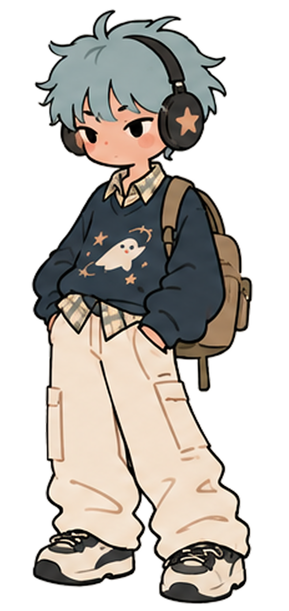
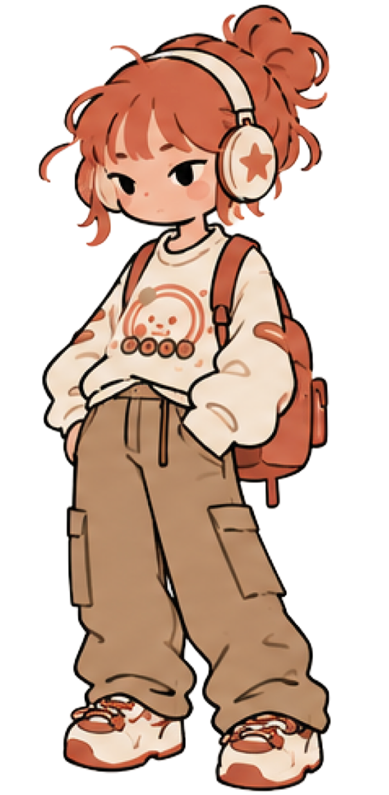

# Character Artwork

This inventory records the 42 character PNGs already present in the shared repository. Asset names are preserved so reviewers can find the same images in the project.

The [original artwork archive](Source-Artwork.md) also includes 10 bag images, six headphone images, and one additional character illustration. These additional files are archived separately and are not integrated into the current app.

## Default character previews

| Default boy illustration | Default girl illustration |
| --- | --- |
|  |  |

## Asset inventory

| Group | Count | Existing PNG files |
| --- | ---: | --- |
| Base model | 1 | [character_model](../../character_model.imageset/character_model.png) |
| Default character illustrations | 2 | [character_default_boy](../../character_default_boy.imageset/character_default_boy.png), [character_default_girl](../../character_default_girl.imageset/character_default_girl.png) |
| Hair — boy asset names | 5 | [character_hair_boy_01](../../character_hair_boy_01.imageset/character_hair_boy_01.png), [character_hair_boy_02](../../character_hair_boy_02.imageset/character_hair_boy_02.png), [character_hair_boy_03](../../character_hair_boy_03.imageset/character_hair_boy_03.png), [character_hair_boy_04](../../character_hair_boy_04.imageset/character_hair_boy_04.png), [character_hair_boy_05](../../character_hair_boy_05.imageset/character_hair_boy_05.png) |
| Hair — girl asset names | 5 | [character_hair_girl_01](../../character_hair_girl_01.imageset/character_hair_girl_01.png), [character_hair_girl_02](../../character_hair_girl_02.imageset/character_hair_girl_02.png), [character_hair_girl_03](../../character_hair_girl_03.imageset/character_hair_girl_03.png), [character_hair_girl_04](../../character_hair_girl_04.imageset/character_hair_girl_04.png), [character_hair_girl_05](../../character_hair_girl_05.imageset/character_hair_girl_05.png) |
| Tops | 9 | [character_top_01](../../character_top_01.imageset/character_top_01.png), [character_top_02](../../character_top_02.imageset/character_top_02.png), [character_top_03](../../character_top_03.imageset/character_top_03.png), [character_top_04](../../character_top_04.imageset/character_top_04.png), [character_top_05](../../character_top_05.imageset/character_top_05.png), [character_top_06](../../character_top_06.imageset/character_top_06.png), [character_top_07](../../character_top_07.imageset/character_top_07.png), [character_top_08](../../character_top_08.imageset/character_top_08.png), [character_top_09](../../character_top_09.imageset/character_top_09.png) |
| Bottoms | 10 | [character_bottom_01](../../character_bottom_01.imageset/character_bottom_01.png), [character_bottom_02](../../character_bottom_02.imageset/character_bottom_02.png), [character_bottom_03](../../character_bottom_03.imageset/character_bottom_03.png), [character_bottom_04](../../character_bottom_04.imageset/character_bottom_04.png), [character_bottom_05](../../character_bottom_05.imageset/character_bottom_05.png), [character_bottom_06](../../character_bottom_06.imageset/character_bottom_06.png), [character_bottom_07](../../character_bottom_07.imageset/character_bottom_07.png), [character_bottom_08](../../character_bottom_08.imageset/character_bottom_08.png), [character_bottom_09](../../character_bottom_09.imageset/character_bottom_09.png), [character_bottom_10](../../character_bottom_10.imageset/character_bottom_10.png) |
| Shoes | 10 | [character_shoes_01](../../character_shoes_01.imageset/character_shoes_01.png), [character_shoes_02](../../character_shoes_02.imageset/character_shoes_02.png), [character_shoes_03](../../character_shoes_03.imageset/character_shoes_03.png), [character_shoes_04](../../character_shoes_04.imageset/character_shoes_04.png), [character_shoes_05](../../character_shoes_05.imageset/character_shoes_05.png), [character_shoes_06](../../character_shoes_06.imageset/character_shoes_06.png), [character_shoes_07](../../character_shoes_07.imageset/character_shoes_07.png), [character_shoes_08](../../character_shoes_08.imageset/character_shoes_08.png), [character_shoes_09](../../character_shoes_09.imageset/character_shoes_09.png), [character_shoes_10](../../character_shoes_10.imageset/character_shoes_10.png) |
| **Total** | **42** | |

## Use in the shared project

The existing [CharacterCustomization.swift](../../CharacterCustomization.swift) layers the base model, shoes, bottoms, tops, and hair in `CharacterArtwork`. Its editor exposes 10 hair choices, nine tops, 10 bottoms, and 10 shoe choices. The two default illustrations are listed separately from those editable layers.

These implementation details describe the current shared project and are not a claim of code authorship. The existing character PNGs are linked rather than copied again.

[Back to contribution overview](README.md)
