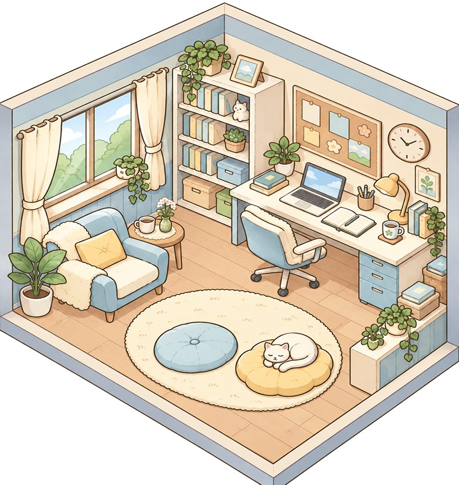
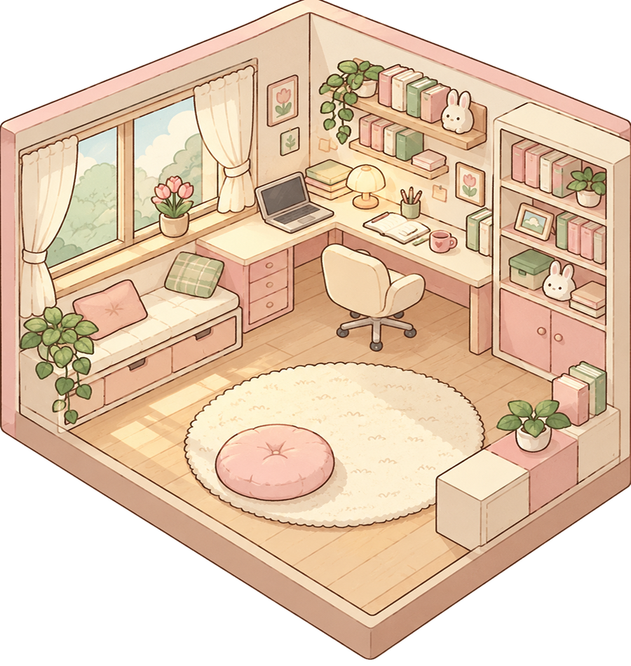
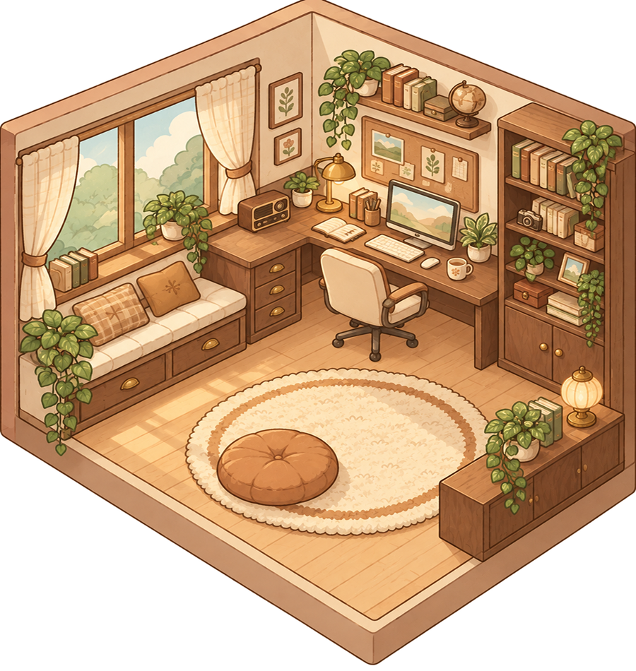
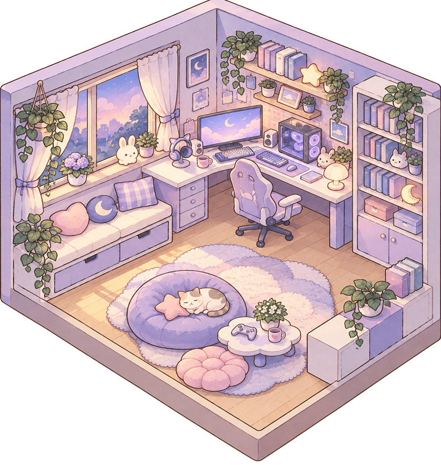

# Room Background Artwork

This inventory records the four room background PNGs already present in the shared repository. Each image is named `room.png` inside a distinct image set.

| Room label in the app | Existing asset | Preview |
| --- | --- | --- |
| Sky Blue | [room_sky](../../room_sky.imageset/room.png) |  |
| Blush Pink | [room_blush](../../room_blush.imageset/room.png) |  |
| Vintage | [room_vintage](../../room_vintage.imageset/room.png) |  |
| Gaming | [room_gaming](../../room_gaming.imageset/room.png) |  |

## Use in the shared project

The existing [CharacterCustomization.swift](../../CharacterCustomization.swift) maps these assets in `RoomChoice` and displays them through `RoomArtwork`. `StudyRoomScene` places the customized character over the selected background as a separate layer.

This is a description of the current shared implementation, not a claim of SwiftUI code authorship. The documentation references existing images without re-exporting or replacing them.

[Back to contribution overview](README.md)
